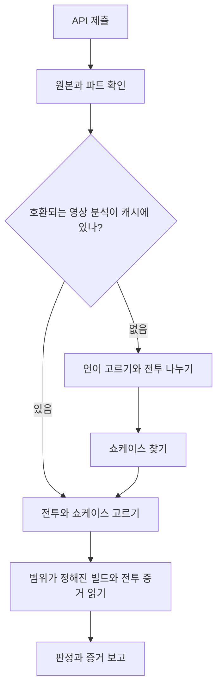

# 원래 리뷰봇을 현재 분석 파이프라인으로 옮기기

**범위:** 분석 엔진의 변경만 다룹니다. 로컬 대기열 파일, 브라우저 유저스크립트, 윈도우 도우미, 로컬 재생 링크와는 무관합니다.

**기준 상태:** 2026-10-16까지 개발된 구현이며, "사라진 뒤 5초 더 보는 종료 창"을 적용한 상태를 포함합니다.

**근거의 한계:** 이 문서는 이 프로젝트 대화에서 볼 수 있었던 코드 스냅숏, 변경, 시험 결과를 설명합니다. 현재 upstream 저장소를 새로 감사한 것이 아닙니다. 예전 구현에 대한 설명은 제공받은 원본 파일과 README 를 가리킵니다. **제안**이라고 표시한 절은 옮길 때의 권고나 안전장치이며 현재 버전에는 구현되어 있지 않습니다.

## 1. 구조의 변화

핵심은 **원본 영상 분석**과 **제출별 판정**을 나누는 것입니다.

제출은 한 전투에 대한 주장입니다. 영상은 여러 전투, 재시작, 쇼케이스, 미리보기, 관계없는 장면을 담을 수 있는 그릇입니다. 둘을 한 덩어리로 다루면 한 런의 증거가 다른 런에 붙습니다.

옮겨진 엔진에는 세 층이 필요합니다.

| 층 | 가진 것 | 제출끼리 다시 쓸 수 있나 |
|---|---|---|
| 원본(Source) | 영상 식별, 파트 식별, 받은 바이트, 길이, 크기 | 예 |
| 영상 분석 | 언어 증거, 경계 이벤트, 전투 시도, 쇼케이스 후보, 진단 | 예, 호환되는 분석 설정 안에서 |
| 제출 분석 | 고른 전투, 고른 쇼케이스, 빌드 배정, 제출값과 관측값 비교, 판정 | 자기 입력과 의존 대상이 같을 때만 |

원래의 API 대기열 수집, 인증, 잡기(claim), 사람의 결정 흐름은 그대로 둡니다. 대기열 실행기는 원본을 준비한 뒤 분석 조정기(coordinator)를 부릅니다. 조정기는 `judge.py`, `hud.py`, `gp.py` 가 돌기 전에 증거의 범위를 정합니다.

스캐너 하나를 바꾸는 것으로 끝나지 않습니다. 고른 구간과 원본 번호가 엔진 전체가 따르는 계약이 되어야 합니다.

## 2. 구현 현황 한눈에

| 변경 | 현재 구현 | 주된 어려움 |
|---|---|---|
| 원본 영상 캐시 나눠 쓰기 | 구현됨 | 주소가 달라도 같은 원본, 빌리빌리 파트는 따로 |
| 영상 단위 전투 나누기 · 쇼케이스 재사용 | 구현됨 | 끝난 CHECK · 빈 결과를 끊긴 작업과 헷갈리지 않기 |
| 이른 언어 고르기 | 불확실성 처리와 함께 구현됨 | 빌드 증거가 없거나, 애매하거나, 처음에서 멀 수 있음 |
| HUD 기반 경계 상태 기계 | 구현됨 | HUD 는 종료 때뿐 아니라 일반 연출 중에도 사라짐 |
| 6초 부재 / HUD 복귀 재시작 찾기 | 구현됨 | 재시작과 연출을 가르려면 글 OCR 이 필요 |
| 사라진 뒤 5초 종료 창 | 손으로 적용한 갱신 | 시작 · 종료 글이 짧은 찾기 창 밖에 있을 수 있음 |
| 처음부터 보이는 HUD 를 추정 시작으로 | 구현됨, 모의 시험까지 | 녹화 시작이 실제 전투 시작은 아님 |
| 타임스탬프로 전투 고르기 | 구현됨 | 미완 시도, 가까운 시작, 어긋남, 애매한 선택 |
| 개별 · 공용 쇼케이스 짝짓기 | 구현됨, 보수적 | 한 원본에서 같은 캐릭터가 다른 빌드로 나올 수 있음 |
| 범위가 정해진 빌드 추출과 조건부 다시 읽기 | 구현됨 | 캐릭터 전환, 사라지는 자물쇠, 덜 그려진 제목 패널 |
| 고른 전투 시트 | 구현됨 | 원본 시각, 올바른 파트 · 번호 유지 |
| 경계 스캔 중 GP 스캔 | 구현 안 됨 | 크롭 · 주기 · 거름 · 결과 뜻이 다름 |
| 중단으로 보기 전에 부재 구간 전체 찾기 | 구현 안 됨 | 놓친 끝을 지어내지 않고 되찾아야 함 |
| 일반 시작 OCR 을 HUD 등장 검출로 대체 | 채택 안 함 | 제안이 취소됨, 시작 OCR 은 2fps 유지 |
| 인카운터 · 보스 자동 확인 | 구현 안 됨 | 제출된 인카운터 글은 관측된 신원 증거가 아님 |

## 3. API 제출을 독립된 런 주장으로 나누기

### 필요한 이전

캐릭터 칸은 1~4개를 받습니다. 광추, 성혼 정수, 중첩 정수는 채워진 칸에 대해서만 검증합니다. 정확히 4명을 요구하지 마세요.

여러 사이드가 든 제출은 독립적으로 고를 수 있는 런 주장으로 나누되, 부모 검토 / 그룹 관계는 유지합니다. 자식마다 자기 제출 식별자, 캐릭터 · 빌드 주장, 타임스탬프가 붙은 원본 주소, 사이드 정보가 필요합니다.

다음 식별자를 따로 둡니다.

- 부모 검토 ID: 사람이 여는 검토 대상
- 자식 런 ID: 분석하는 런 주장
- 원본 ID: 다시 쓸 수 있는 영상 객체
- 파트 ID: 여러 파트 원본 안의 고른 파트
- 전투 구간: 그 파트에서 고른 시도

### 왜 어려운가

묶인 제출에는 서로 다른 원본 주소가 있는 사이드 셋, 한 주소 안에 타임스탬프 셋, 또는 타임스탬프 없는 첫 사이드 뒤에 타임스탬프가 있는 둘이 올 수 있습니다. 나누면서 자식 주소를 부모 주소로 덮어쓰거나 자식 ID 를 부모 검토 ID 에 합치면 안 됩니다.

그래서 한 검토가 같은 부모에 묶인 런 보고를 여럿 낼 수 있습니다. 그 보고들을 하나의 검토 결정으로 어떻게 합칠지는 증거 추출과 별개의 API / 제품 정책입니다.

지금의 독립 런 흐름을 보고, 나누지 않은 `runs` 객체를 원래 실행기에 그대로 넘기면 사이드별로 같은 결과가 나온다고 읽으면 안 됩니다. API 어댑터가 이 정규화를 일부러 해야 합니다.

## 4. 원본 식별과 받기

### 필요한 이전

`video_cache.py` 같은 모듈로 원본 저장소를 나눠 씁니다. 런이 제출마다 새로 받게 하지 말고 준비된 미디어를 가리키게 합니다.

알려진 제공자는 그쪽 미디어 식별자로 식별을 정규화합니다. 타임스탬프와 추적 매개변수가 서로 다른 유튜브 원본을 만들면 안 됩니다. 빌리빌리의 `p=` 는 지킵니다. 2파트와 3파트는 전혀 다른 전투 · 빌드를 담을 수 있습니다.

원본 목록(manifest)에는 어떤 원본 / 파트가 어떤 준비된 파일인지 적습니다. 온라인 출처 정보를 남겨 보고가 올바른 파트 · 타임스탬프로 이어지게 합니다.

### 주소가 같다고 같은 영상이 아닌 이유

같은 유튜브 영상이 짧은 주소, watch 주소, 추적 · 타임스탬프가 붙은 주소로 나옵니다. 반대로 같은 BV 번호의 빌리빌리 주소가 서로 다른 파트를 가리킬 수 있습니다.

층마다 필요한 열쇠가 다를 수 있습니다. 여러 파트 컨테이너는 받기 정보를 나눠 쓸 수 있지만, 파트별 준비 파일은 각자 내용 식별이 필요합니다. 이를 하나의 일반 「영상 열쇠」로 뭉치지 마세요.

### 제안하는 배포 안전장치

API 서비스에 워커가 여럿이면 받기와 게시에 원본별 조정을 더하세요. 우리가 개발한 단일 프로세스 흐름은 동시 쓰기가 안전하다는 것을 보이지 않습니다.

준비가 성공한 뒤에만 완성된 파일 / manifest 를 게시하세요. 디렉터리가 디스크에 있다고 받기나 분석이 끝났다는 증거가 아닙니다.

## 5. 캐시 설계는 정확성의 일부다

### 필요한 이전

다시 쓸 수 있는 단계를 따로 캐시합니다.

| 산출물 | 의존하는 것 |
|---|---|
| 준비된 미디어 | 원본 / 파트 식별과 실제로 받은 내용 |
| 경계 스캔 | 내용, OCR 모델, 크롭 / 검출기 논리, 표본 · 복구 설정 |
| 쇼케이스 스캔 | 내용, 관련 경계 / 제외 구간, 쇼케이스 검출기 · 설정 |
| 빌드 추출 | 내용, 원본 번호, 고른 쇼케이스 구간, 추출 코드 · 설정 |
| 빌드 해석 | 추출된 증거, OCR / 모델 / 자료 버전, 후보 신원, 읽기 논리 |
| 전투 시트 | 내용, 고른 구간, 표본 · 배치 설정 |
| 제출 판정 | 주장, 고른 증거, 분석 결과 |

CHECK 를 냈거나 완전한 전투가 없던 경계 스캔도 끝난 것이면 다시 씁니다. 같은 영상을 가리키는 다른 제출이 있다는 이유만으로 스캔을 되풀이할 까닭이 되지 않습니다.

지금의 쇼케이스 흐름은 완료 표시와 서명을 씁니다. 끝났지만 비었거나 불확실한 스캔과, 유효한 결과를 게시하기 전에 멈춘 프로세스를 구별하기 위해서입니다.

### 고려할 복잡함

**없다는 결과에도 출처가 필요하다.** 옛 모델 · 크롭으로 「배너를 못 찾음」이라 나왔다고 그것이 검출기를 바꾼 뒤에도 영구한 진실이 되면 안 됩니다. 호환되는 서명 안에서만 다시 쓰고, 관련 입력이 바뀌면 무효로 합니다.

**존재가 완료는 아니다.** 반쯤 쓰인 JSON 파일, 빈 출력 디렉터리, 찾은 것이 0 개인 끝난 스캔은 세 가지 다른 상태입니다.

**캐시의 정확성은 층마다 따로다.** 보고 형식만 고쳤다면 받은 미디어를 무효로 할 필요가 없습니다. 경계 코드를 고치면 쇼케이스 간격과 그 아래 선택이 무효가 될 수 있습니다. 모든 캐시를 전역으로 유효하거나 전부 지우는 둘 중 하나로 다루지 마세요.

**언어 고르기는 제출에 따라 달라질 수 있다.** 이른 선택기는 제출된 이름을 맞출 후보로 씁니다. 그래서 원본 단계 캐시에서는 나중 제출이 다른 캐릭터 집합이나 명시적 모델 지정을 줄 때를 조심해야 합니다. 분석 산출물이 영상 캐시 폴더에 있다는 이유만으로 모두 주장과 무관하다고 보지 마세요.

**코드 서명에는 한계가 있다.** 현재 흐름은 관련 파일과 설정을 지문으로 만듭니다. 실서비스로 옮길 때는 결과를 바꾸는 모든 모델 · 템플릿 · 자료 의존이 알맞은 열쇠에 들어가는지 감사해야 합니다. 이는 권고이며 현재 의존 범위가 빠짐없다는 주장이 아닙니다.

**보관에도 의존 관계가 있다.** 보고나 추출된 증거가 여전히 가리키는데 캐시된 영상을 지우면, 검토자가 볼 수 있는 것이 달라집니다. 원본과 파생 산출물의 보관 규칙을 함께 정하세요.

## 6. 언어 고르기를 경계 스캔 앞으로

### 필요한 이전

원래의 빌드 읽기 언어 고르기를 경계 스캔을 이끌 만큼 일찍 쓸 수 있어야 합니다. 메뉴 / 빌드 표본 뽑기와 현지화된 캐릭터 · 광추 맞추기를 다시 쓰고, 쇼케이스가 있을 만한 영상 끝 쪽도 찾습니다.

점수는 보수적으로 매깁니다. 글자 체계 증거는 선택에 보태지만, 약한 이름 일치나 아슬아슬한 경쟁 모델은 불확실성으로 남깁니다. 채택된 동작은 옛 선택으로 이어 가면서 CHECK 경고를 붙이는 것이고, 즉시 끝내지 않습니다.

경계는 고른 모델로 먼저 스캔합니다. 그 모델의 기존 결과는 다시 쓸 수 있어야 합니다. 다른 모델은 복구 경로이며, 성공한 스캔을 모든 언어로 무조건 되풀이할 까닭이 아닙니다.

### 왜 어려운가

- 쇼케이스는 처음, 전투 사이, 또는 끝에만 있을 수 있습니다.
- 쇼케이스가 아예 없을 수도 있습니다.
- OCR 은 다른 언어의 글을 부분적으로 알아볼 수 있습니다. 알아봤다고 언어가 확정되지는 않습니다.
- 관계없는 글을 받아들이면 워터마크, 플레이어 이름, UI 라벨이 깨진 제목보다 점수가 높게 나옵니다.
- 제출된 캐릭터 집합이 다르면 후보 맞추기 증거가 달라집니다.
- 검출기가 글자 체계에는 확신해도 특정 모델이나 제목에는 확신하지 못할 수 있습니다.

작성자 이름의 글자를 영상 게임 언어의 증거로 삼지 마세요. 맥락 증거가 될 수 있다고만 논의했고, 믿을 만한 언어 선택기로 확립된 것은 아닙니다.

선택 후보, 점수, 불확실 사유, 실제로 쓴 모델을 기록하세요. 보고서가 대체 경로를 조용히 확실한 것처럼 보이지 않고 설명해야 합니다.

## 7. HUD 기반 경계 스캐너 더하기

### 상태와 표본 뽑기

| 상태 | 동작 | 확인 |
|---|---|---|
| 시작 찾기 | 위쪽 가운데 배너 영역을 2fps 로 OCR | 그냥 시작 또는 첫 웨이브 `1/x` 글 |
| 전투 중 | 오른쪽 위 HUD 를 2fps 로 시각 맞춤 | 있는지만 추적 |
| 오래 사라짐 | 15초 동안 없으면 앞선 사라진 구간을 8fps 로 살핌 | 인식된 경계 글 |
| HUD 복귀 | 6초 이상 없다가 양성 표본 둘이면 복귀 구간을 8fps 로 살핌 | 새 시작 또는 종료 인식 |
| 전투 중인데 풀리지 않음 | 4fps 로 넓게 복구 | OCR 증거, 없으면 미완 |
| 시작이 어디에도 없음 | 전 구간 4fps 복구 | OCR 증거, 없으면 CHECK |

`2/2` 같은 중간 웨이브는 완전한 구간에 필요하지 않습니다. 번호 없는 그냥 시작도 유효합니다. 중간 웨이브는 남겨 둔 복구 경로의 진단 단서로만 쓸 수 있습니다.

사라진 구간은 마지막 양성 HUD 표본 약 2초 전에서 시작하고, 이제 부재가 시작된 뒤 5초까지 늘어납니다. 복귀 구간은 확인 표본 2.5초 전부터 3초 뒤까지입니다.

### HUD 검출기 세부

현재 검출기는 활성 화면 너비를 정규화하고, 오른쪽 위 영역을 떼어, 밝고 채도 낮은 아이콘 픽셀만 거른 뒤, 여러 크기의 템플릿과 견줍니다. 일시정지가 주된 단서이고, 속도 / 자동 맞춤은 대안입니다.

왼쪽 행동 순서 템플릿은 맞춤이 나빠 뺐습니다. 현재 검출기가 화면 양쪽 모두 사라져야 한다고 적지 마세요.

좌우 대칭의 가로 검은 띠 처리는 남아 있습니다. 이것이 모든 필러박스, 중심에서 벗어난 크롭, 태블릿 배치, 모바일 UI 배율, 겹쳐 얹은 녹화에서 맞게 돈다는 증거는 아닙니다.

### 왜 오래 사라져야 하는가

조작 단추는 전투 종료 때뿐 아니라 연출 중에도 사라집니다. 사라짐은 OCR 찾기를 예약해야 하고, 종료 시각을 만들어 내서는 안 됩니다.

HUD 복귀를 확인할 때 양성 표본 둘이 이어져야 합니다. 한 번의 우연한 템플릿 일치가 부재 상태를 곧바로 되돌리지 않게 하려는 것입니다. 2fps 에서 두 표본은 0.5초 간격입니다.

6초와 15초는 다른 목적입니다. 짧은 재시작 확인은 일반 연출 둘레의 OCR 을 더 쓰고, 긴 종료 확인은 짧은 연출을 종료 신호로 오인하는 것을 막습니다.

### 확인을 기다리는 동안 영상을 다시 봐야 한다

종료가 시각 `E` 에 있었는데 15초 부재가 확인되는 것은 나중인 `C` 일 수 있습니다. 종료를 인식했으면 `C` 가 아니라 `E` 바로 뒤부터 시작 찾기를 다시 시작합니다.

그렇지 않으면 그 기다리는 동안 시작한 새 전투를 건너뛸 수 있습니다. 구현은 그 구간을 일부러 다시 봅니다.

### 표본 위상이 중요하다

짧은 배너는 2fps 표본 사이로 빠질 수 있습니다. 짧은 구간 안에서 8fps 로 올리면 잡을 기회가 늘지만 인식 정확도를 보장하지는 않습니다. 프레임 생성기의 탐색 지점과 표본 위상도 명목상의 시각에 영향을 줍니다.

원본 시각과 표본 정보를 남기세요. 시험할 때는 서로 다른 격자에서 나온 분수 시각이 똑같기를 요구하지 말고 허용 오차를 두고 경계를 견주세요.

## 8. 재시작, 포기한 시도, 없는 종료

### 필요한 표현

구간에는 시작과 끝 필드, 상태, 경고, 출처가 따로 있어야 합니다. 없는 끝은 없는 채로 둡니다. 포기한 시도를 다음 시작에서 닫고 그 인위적 끝점을 확인된 「Battle Over」처럼 다루지 마세요.

앞 시도에 끝이 없는데 새 시작이 인식되면, 앞 시도는 미완 / CHECK 로 남기고 새 구간을 만듭니다. 두 시각을 모두 저장하고 기록합니다.

시험한 재시작 사례에서 미완 시도는 `839.625s` 에, 재시작은 `882.75s` 에 시작했습니다. 앞쪽 전환 둘레의 HUD 사라짐 찾기는 재시작을 포함하지 않았고, HUD 복귀 OCR 을 더하자 찾았습니다.

### 현재의 한계: 놓친 끝과 진짜 재시작

새 시작은 다른 전투가 시작했다는 것만 증명합니다. 앞 전투가 왜 멈췄는지는 증명하지 않습니다.

시험한 두 번째 영상에서는 시작이 `188.5s`, HUD 사라짐이 `516.5s`, 다음 시작이 `537s` 였습니다. 종료 OCR 은 처음에 약 `519.5s` 에서 멈췄고, 사용자는 `520s` 근처에서 Battle Over 를 봤다고 알렸습니다. 스캐너는 그 끝을 인식하지 못했으므로 앞 전투를 미완으로 표시했습니다.

적용한 변경은 종료 찾기를 `부재 시작 + 5초` 까지 늘립니다. 이는 찾기 창이 덮는 범위의 문제를 다루지만, 실제 인식은 여전히 시험이 필요합니다.

### 제안하는 추가 복구 — 현재 구현되지 않음

새 시작으로의 전환을 앞 시도의 미완으로 분류하기 전에, 그 사이 부재 구간에서 아직 살피지 않은 부분에서 Battle Over 를 찾으세요.

이 찾기는 그 구간 안으로 제한하고 새 시작 앞에서 멈춥니다. 믿을 만한 끝을 못 찾으면 미완 / CHECK 로 둡니다. 다른 시작이 있다는 사실만으로 끝을 추정하는 것보다 낫습니다.

## 9. 전투 도중에 시작하는 영상과 처음의 미리보기

### 현재 동작

2fps 첫 두 표본에서 HUD 가 검출되면, 스캐너는 스캔 범위의 처음에 추정 시작을 만들 수 있습니다. 그러면 존재하지 않는 시작 배너를 영상 전체에서 찾는 대신 진행 중인 전투를 평소대로 추적합니다.

인식된 시작 배너가 우선합니다. 합성된 이벤트는 `source: opening_hud`, `start_inferred: true` 를 가지며, 구간에도 추정 시작 정보가 남습니다.

### 복잡함

- 시각 0 은 가진 영상의 처음이지 실제 전투의 처음이 아닐 수 있습니다.
- 영상이 종료 장면 미리보기로 시작했다가 전체 런을 보여 줄 수 있습니다.
- 시작 연출이 첫 표본에서 HUD 를 가릴 수 있습니다.
- 두 표본 모두에서 템플릿이 오검출하면 틀린 추정 시작이 나옵니다.
- 잘린 시작은 주장과 관련된 앞쪽 사이클, 피해, GP 증거를 빠뜨릴 수 있습니다.

처음 HUD 동작은 모의 논리 시험만 거쳤습니다. 넓은 실제 영상 검증과는 다릅니다.

기존 파서는 나중의 첫 시작 앞에 짝 없는 종료 글이 있으면 미리보기로 볼 수 있게 처리합니다. 처음 추정과 미리보기 처리는 편집된 모든 영상에서 호환된다고 가정하지 말고 함께 시험하세요.

### 제안하는 출처 전파

추정 시작이라는 출처를 최종 선택과 보고까지 가져가고, 잘린 처음에 어떤 검토 정책을 쓸지 정하세요. 지금의 선택 객체는 주로 고른 구간만 실으며, 모든 이벤트 단위 주석이 보고에 자동으로 보인다고 가정하지 마세요.

## 10. 완전한 전투와 제외 구간 나누기

### 필요한 이전

영상 안의 시도한 전투가 모두 완전해야 성공한 전투 하나를 분석할 수 있는 것은 아닙니다.

타임라인을 이렇게 나눕니다.

1. 쓸 수 있는 완전한 전투 구간
2. 확인된 전투로도, 일반 쇼케이스 사이 간격으로도 다루면 안 되는 미해결 구간

끝이 없는 시도의 제외 구간은 다음에 알려진 시작이나 영상 끝까지 늘어날 수 있습니다. 이는 간격 검출을 가리는 구간을 닫는 것이지 사실의 전투 구간이 아닙니다.

겹치는 제외 구간은 합치고, 선택이 일관되지 않을 만큼 쓸 수 있는 전투와 미해결 구간이 겹치면 거부합니다.

### 왜 구별해야 하나

재시작 구간을 통째로 버리면 쇼케이스 검출기가 게임 장면을 쇼케이스 사이 간격으로 오인해 뒤질 수 있습니다. 미해결 시도가 하나만 있어도 원본 전체를 막으면, 나중의 분명히 완전한 전투를 못 씁니다.

그래서 조정기는 간격 스캐너에 합성 제외 장벽을 넘기면서, 진단을 위해 원래의 시도와 경고는 남깁니다. 그러면 번호를 다시 매겨야 합니다. 간격 스캐너의 「3번 구간 뒤」는 세 번째로 끝난 전투가 아닌 제외 장벽을 포함할 수 있습니다.

여기서 번호가 하나 어긋나면, 각 검출이 따로는 맞아도 맞는 쇼케이스가 틀린 전투에 붙습니다.

## 11. 제출의 전투 고르기

### 옮길 현재 규칙

| 상황 | 선택 동작 |
|---|---|
| 타임스탬프가 완전한 전투 정확히 하나 안에 있음 | 그것을 고른다 |
| 전투 밖인데 다음 90초 안에 완전한 시작이 하나 | 그 전투를 고른다 |
| 포함하거나 뒤따르는 후보가 둘 이상 | CHECK |
| 고른 시작이 제출 타임스탬프와 30초 넘게 앞뒤로 다름 | CHECK 사유를 더한다 |
| 선택이 미해결 시도를 건너뜀 | CHECK 사유를 더한다 |
| 타임스탬프가 검출된 쇼케이스 안을 가리킴 | CHECK |
| 타임스탬프가 없거나 0 | 첫 시도를 본다. 앞선 미완 시도가 있으면 조용히 건너뛰지 못한다 |

제출된 위치, 검출된 시작, 부호 있는 어긋남, 앞으로 당겨 잡았는지, 미완 시도를 건너뛰었는지를 저장하세요.

### 어려운 경우

**가까운 미완 전투:** 가장 가까운 시작이 있어도 끝이 인식되지 않았을 수 있습니다. 완전한 전투만 고르는 선택기는 링크가 가깝다는 이유로 그것을 고를 수 없습니다. 「타임스탬프가 하나의 전투를 가리키지 않음」이라고만 쓰지 말고 그 밑바닥 사유를 보고하세요.

**재시작 앞의 타임스탬프:** 타임스탬프가 포기한 시도, 그 준비, 또는 뒤이은 성공한 런 중 무엇을 가리키는지 알 수 없습니다. 앞으로 90초 규칙은 검토 경고가 붙은 정책이지 업로더의 의도를 증명하지 않습니다.

**정확한 경계 의미:** 끝 시각을 포함할지 정하세요. 한 구간이 끝나는 곳에서 다른 구간이 시작한다고 인접한 두 구간을 모두 고르지 마세요.

**주소 형식:** 초와 길이 꼴 타임스탬프를 일관되게 읽고, 빌리빌리 파트 선택을 지키며, 알려진 잘못된 짧은 링크는 일부러 처리하세요. 모르는 타임스탬프 문법이 조용히 0 이 되면 안 됩니다.

**캐시와 주장:** 제출 타임스탬프를 바꾸면 보통 원본 전체 경계를 다시 스캔하지 않고 기존 원본 분석에서 다시 골라야 합니다.

## 12. 쇼케이스 찾기와 짝짓기

### 필요한 이전

자격이 있는 간격에서 캐릭터 메뉴 증거를 찾아 후보 구간을 저장합니다. 원본 번호, 시작 / 끝, 찾기 창 범위, 메뉴 페이지 증거, 순서상 위치를 함께 둡니다.

시간 구조로 짝짓습니다.

- 전투 사이사이, 전투마다 대응하는 쇼케이스
- 여러 전투 앞의 공용 쇼케이스 하나
- 여러 전투 뒤의 공용 쇼케이스 하나
- 같은 자격 간격에 있는 가까운 조각들

지금 구현은 조각을 간격 / 순서 정보로 묶고, 구간과 증거를 합치며, 섞였거나 불확실한 형태는 보수적으로 거부합니다. 공용 후보는 사람 확인 사유를 만듭니다.

### 가까움만으로는 짝짓기에 부족한 이유

가장 가까운 쇼케이스가 앞 전투의 것일 수도, 영상 전체의 것일 수도, 나중에 편집으로 끼운 것일 수도 있습니다. 같은 빌드를 두 번 보여 주는 반복 쇼케이스가 서로 다른 쇼케이스 두 번으로 보일 수도 있습니다.

원시 쇼케이스 조각 수가 전투 수와 같기를 요구하지 마세요. 반대로, 사이에 전투 장면이 있는데도 가까운 메뉴 세션을 모두 자동으로 합치지도 마세요.

### 제출값과 맞는다고 빌드를 고르지 말 것

순서 짝짓기는 제출된 E / S / LC 값과 가장 잘 맞는 쇼케이스를 고르면 안 됩니다. 증거 선택이 승인 쪽으로 기울기 때문입니다.

공용 구간을 골랐으면 그 안의 빌드 등장을 따로 찾아 읽으세요. 같은 캐릭터가 다른 빌드로 나오는데 전투와 등장의 대응이 애매하면 CHECK 를 냅니다.

### 남은 특수 경우

여러 파트 영상에서는 쇼케이스가 다른 파트에 있을 수 있습니다. 지금의 고른 파트 동작은 독립 파트끼리 오염되는 것을 막지만, 관련 없어 보이는 어느 파트가 쇼케이스를 대 주는지 정하는 일반 규칙은 세우지 못했습니다. 모든 파트를 받으면 짝짓기가 풀린다고 가정하지 마세요.

## 13. 추출과 모든 다시 읽기의 범위를 일관되게

### 필요한 이전

추출과 판정에 하나의 선택 계약을 넘기세요. 전투 원본 / 번호 / 구간과 빌드 원본 / 번호 / 구간을 구별해야 합니다.

광추 / 성혼 프레임의 첫 목록뿐 아니라 모든 코드 경로를 고치세요.

- 첫 메뉴 추출
- 빌드를 읽는 중의 언어 표본
- 캐릭터 상세(Details) 맞추기
- 캐릭터 신원 배정
- 광추와 성혼 프레임 모으기
- 원래 해상도 / 더 촘촘한 재시도 디코딩
- 빌드 시트 만들기

이전의 여러 파트 문제는 첫 프레임 거름을 바꿔도 다른 맞추기 반복이 여전히 모든 영상 번호를 돌아서 남아 있었습니다. `videos`, `tabs<i>`, 재시도 디코딩 프레임을 도는 모든 반복을 감사하세요.

### 타임스탬프와 좌표 계약

증거에는 원본 시각을 붙여 두세요. 디코더가 쇼케이스 안으로 탐색했다면 구간 기준 프레임 시각을 영상 전체 시각으로 보고하지 마세요.

이미지 좌표도 일관되게 두세요. 크롭 오프셋, 활성 화면 오프셋, 메뉴 배치 좌표는 서로 다른 공간입니다. 프레임 밖을 자르는 노드 크롭은 OpenCV 오류가 아니라 읽을 수 없는 증거가 되어야 합니다.

프레임 파일 이름은 진단에는 쓸모 있지만 증거의 유일한 식별이어서는 안 됩니다. 여러 재시도가 가까운 시각을 쓸 수 있고, 다른 파트가 같은 시각을 담을 수 있습니다.

## 14. 캐릭터 신원은 E / S / LC 읽기와 별개의 결정이다

### 필요한 이전

캐릭터 머리글 증거, 현지화된 성혼 이름 증거, 가까운 상세 페이지, 그 밖의 지원되는 신원 단서로 페이지를 캐릭터에 배정하세요. 약하거나 애매한 배정 정보를 남기세요.

성혼 개수를 맞게 읽어도 엉뚱한 캐릭터에 붙으면 틀린 결과입니다. OCR 표본을 더 늘려도 이 배정 문제는 풀리지 않습니다.

### 어려운 경우

- 캐릭터를 바꿀 때 머리글이 페이지 내용보다 먼저 바뀝니다.
- 워터마크가 머리글을 가려도 성혼 이름은 읽힐 수 있습니다.
- 제출된 여러 캐릭터가 같은 광추를 씁니다.
- 개척자의 플레이어 이름은 제출된 캐릭터 이름이 아닙니다.
- 제출된 팀에 없는 캐릭터가 공용 쇼케이스에 나옵니다.
- 페이지가 빠지면 소거법 배정이 남은 한 캐릭터로 몰아갑니다.

조건부 재시도는 표본 프레임이 여전히 의도한 캐릭터의 것인지 확인해야 합니다. 그렇지 않으면 재시도가 엉뚱한 배정의 증거를 키웁니다.

The Herta 의 성혼 페이지를 Anaxa 에 배정했던 이전 사고는 이런 부류의 실패를 보여 주지만, 지금의 재시도가 모든 신원 사례를 풀었다는 뜻은 아닙니다.

## 15. 조건부 빌드 다시 읽기와 불확실성

### 필요한 이전

증거가 분명할 때는 보통의 빠른 경로를 지키세요. 풀리지 않았거나 모순될 때만 더 촘촘히 읽습니다.

| 읽기 | 다시 읽는 동기 | 주된 실패 양상 |
|---|---|---|
| 광추 제목 | 약하거나 불확실한 제목 일치, 알맞지 않은 프레임 | 제목 패널이 자리 잡기 전에 열린 페이지, UI 라벨을 제목으로 오인 |
| 중첩 | 없거나 충돌하는 S 읽기 | 작은 글씨, 흐림, 엉뚱한 줄, 페이지 전환 |
| 성혼 | 모순된 자물쇠 패턴, 부족한 프레임 지지, 불확실한 노드 점수 | 사라지는 자물쇠, 크기 불일치, 엉뚱한 탭, 엉뚱한 캐릭터 |

다시 읽기는 고른 쇼케이스와 캐릭터 맥락 안에서 하세요. 재시도 메타데이터와 증거 프레임을 저장해 결과를 확인할 수 있게 합니다.

### 성혼 관련 복잡함

자물쇠 검출은 여섯 개의 독립된 이진 분류가 아닙니다. 읽기는 순서대로 풀리는 패턴과 맞아야 하고, 알맞은 여러 프레임이 뒷받침해야 합니다.

채택한 방향은 더 잘게 나눈 템플릿 크기 탐색과, 같은 캐릭터로 확인된 프레임들에 걸친 자물쇠 증거의 합산이었고, 증거가 여전히 모순되면 CHECK 를 유지합니다. 캐릭터나 움직이는 전환을 가리지 않고 점수를 섞으면 합산이 망가집니다.

여러 프레임에 걸친 최댓값은 고립된 오검출을 키울 수 있습니다. 반복된 지지와 확신 문턱이 중요합니다. 프레임이 많다고 증거가 저절로 강해지지 않습니다.

### 광추 관련 복잡함

제목 다시 읽기가 약한 제목 증거를 또렷이 읽히는 일반 UI 라벨로 바꾸면 안 됩니다. 알맞지 않은 프레임에서 중국어 `角色攻略` 가 읽힌 것이 그 예였습니다. 표본을 더한 것만으로 완전히 해결되었다고 확립된 것은 아닙니다.

다시 읽은 결과는 읽을 수 있는 다른 광추, 불확실한 후보, 쓸 만한 제목 증거 없음을 구별해야 합니다.

## 16. HUD 수치, UID, 보유 효과 확인의 범위

### 필요한 이전

고른 전투 / 빌드 원본과 구간을 `auto_judge.py` 와 그 의존 대상에 넘기세요. 전투 수치와 GP 작업의 범위를 고른 전투로 좁히고, 증거에 올바른 원본 번호를 유지하세요.

원래의 결과 논리는 이 특정 시도에 속하는지 알 수 없는 마지막 요약 화면이 아니라, 관련 있는 전투 중 증거를 계속 써야 합니다.

경계 나누기에 쓰는 HUD 존재 여부와 `hud.py` 의 HUD 값 읽기는 다른 검출기입니다. 일시정지 아이콘이 맞는다고 사이클 카운터를 읽을 수 있다는 뜻이 아닙니다.

### 보유 효과(GP)는 따로 남는다

경계 OCR 과 GP OCR 은 공간 영역, 배너 글, 거름, 표본 필요가 다릅니다. 지금 구현은 이 두 단계를 합치지 않고, 나누는 도중에 GP 작업을 병렬로 시작하지도 않습니다.

이전의 GP 조사는 두 가지 다른 문제를 드러냈습니다. 지나치게 너그러운 글 맞추기가 오검출을 만들 수 있고, 갈라진 줄의 OCR 과 전처리 / 거름 결정이 놓침을 만들 수 있다는 것입니다. 크롭을 넓히거나 일치 문턱을 낮추는 것만으로는 완전한 이전 전략이 아닙니다.

### 제안하는 GP 캐시 설계

GP 결과를 영상 전체로 캐시한다면, 시각이 붙은 관측과 반복된 증거를 남겨 고른 구간마다 따로 답할 수 있게 하세요. 「카스토리스가 어딘가에서 보임」 같은 영상 단위 합집합으로는 부족합니다. 전투 3 의 발동이 전투 1 의 주장을 채워서는 안 됩니다.

이 설계가 이미 구현된 것으로 다루지 마세요.

## 17. 판정의 의미와 보고

### 필요한 이전

다음 범주를 따로 두세요.

- 확정된 관측 불일치
- 읽을 수 없거나 모순되는 증거
- 잡히지 않았거나 배정되지 않은 증거
- 애매한 전투 / 쇼케이스 짝짓기
- 분석 예외 또는 없는 의존 대상
- 보고 전달 실패

경계 나누기와 언어 고르기의 경고를 최종 사람 확인 사유로 전파하세요. 높은 숫자 신뢰도가 범주형 CHECK 조건을 지워서는 안 됩니다.

분석이 일찍 멈추면 제출된 빌드를 「확인 안 됨」이라고 분명히 표시해 보여 주세요. 주장을 관측된 증거인 양 보이거나 팀을 아예 빼면 안 됩니다.

타임스탬프 선택 정보, 온라인 증거 링크, 고른 빌리빌리 파트, 원래 배포에 맞는 진단 참조를 넣으세요. 로컬 폴더와 mpv 경로는 이 이전의 범위 밖입니다.

### 실패 설명을 개선하기

「타임스탬프가 전투 하나를 가리키지 않음」이라는 보고는 끝을 놓친 가까운 시작이 검출되었다는 사실을 가릴 수 있습니다. 쓸모 있는 설명은 실패한 단계와 없는 증거를 짚습니다.

신뢰도는 감점 방식의 증거 점수이며, 검토 정확도의 보정된 확률이 아닙니다. 인카운터 신원과 중복 사이트 확인은, 따로 구현하지 않는 한 별개의 한계로 남습니다.

## 18. 고른 증거 시트

### 필요한 이전

고른 전투 구간에 대해서만 전투 시트를 만드세요. 원래 시각을 지키고, 원본과 구간별로 캐시하며, 이전 구간의 낡은 페이지는 지우거나 제외하세요.

빌드 시트에는 고른 쇼케이스를 쓰세요. 공용 구간은 여러 런의 빌드를 담을 수 있으므로 그 해석에는 여전히 경고가 따라야 합니다.

빌드 시트와, 있으면 전투의 첫 페이지와 마지막 페이지를 붙이세요. 전투 페이지가 하나뿐이면 두 번 붙이지 말고 중복을 없애세요.

### 복잡함

- 전투 영상 번호가 쇼케이스 번호와 다를 수 있습니다.
- 짧은 구간은 한 페이지, 긴 구간은 여러 페이지가 나옵니다.
- 표본이 끝 시각에 정확히 떨어지지 않을 수 있으므로 끝점을 잡는 처리가 필요합니다.
- 영상 끝으로의 탐색이 실패할 수 있어 한계가 있는 대체 경로가 필요합니다.
- 구간 탐색 뒤에도 시트의 시각은 온라인 원본 시각이어야 합니다.
- 폴더가 있다는 이유만으로 낡은 `01.jpg`, `02.jpg` 등이 유효하다고 가정할 수 없습니다.
- 디스코드의 이미지 묶음과 첨부 전달은 증거 선택과는 별개의 표현 문제입니다.

## 19. API 배포에서의 긴 영상 정책

현재 정책은 로컬 파일 없이도 옮길 수 있습니다.

| 길이 | 정책 |
|---|---|
| 20분까지 | 보통대로 받아들인다 |
| 20분 초과 ~ 1시간 미만 | 그 원본을 가리키는 서로 다른 제출 ID 둘이 올 때까지 기다린다 |
| 1시간 이상 | 자동 분석 대신 CHECK |

일시적인 대기열 응답과 별개로 영속 저장소를 쓰세요. 한 제출이 중복해서 나타났다고 두 참조 요건을 채워서는 안 됩니다.

보류된 런은 첫 건이 지금 가져오는 대기열 페이지에서 사라졌더라도, 다른 참조가 도착하면 다시 대상이 되어야 합니다. 안전하게 다시 따져 볼 수 있도록 입력 / 출처 정보를 충분히 남기세요.

**제안하는 배포상의 걱정:** 워커가 여럿인 서비스에서는 받아들임 / 참조 갱신과 보류 작업 활성화에 동시성 제어가 필요합니다. 로컬의 단일 쓰기 레지스트리는 서비스 수준 설계를 대신하지 못합니다.

## 20. 원래 저장소에서 손댈 곳

| 구성 요소 | 이전할 책임 |
|---|---|
| 원래 API 대기열 실행기 | 독립된 런 주장 정규화, 원본 / 선택 조정기 호출, 기존 API 흐름 유지 |
| `prep.py` / 미디어 준비 | 원본 다시 쓰기, 파트 식별과 온라인 출처 유지 |
| `video_cache.py` | 원본과 파생 산출물 다시 쓰기, 명시적 완료 / 무효화 |
| `segment_pipeline.py` | 이른 언어 증거, 캐시된 영상 분석, 나누기, 전투 선택, 쇼케이스 짝짓기, 추출 범위 |
| `scan_battle_boundaries.py` | HUD 상태 기계, 글 맞추기, 추정 시작, 재시작, 복구와 진단 |
| `scan_showcases.py` | 간격 범위 안의 메뉴 검출과 후보 증거 |
| `tabs.py` 연동 | 고른 쇼케이스 증거만 추출하고 원본 좌표 / 시각 유지 |
| `judge.py` | 신원을 따지는 빌드 읽기, 조건부 재시도, 불확실성 출력 |
| `auto_judge.py` | 고른 번호 / 구간을 받아 결과와 CHECK 사유를 합침 |
| `hud.py` / `gp.py` 호출부 | 증거를 고른 런 / 원본으로 한정 |
| `battle_sheets.py` 또는 그에 해당하는 것 | 구간별로 캐시되는 증거 시트 |
| `report.py` | 관측값과 제출값의 명확한 대비, 시각 / 짝짓기 경고, 고른 온라인 증거 |
| 영속 서비스 저장소 | 선택 사항인 긴 영상 참조와 보류 작업 |

로컬 실행기를 통째로 원래 실행기에 복사하지 마세요. 분석 계약과 조정기 호출을 옮기고, 원래 실행기의 오류 처리, 작업 수명 주기, 전달 동작에 맞추세요.

## 21. 권장 이전 순서

다음은 제안하는 구현 순서이며, upstream 에 이미 이 단계들이 있다는 주장이 아닙니다.

1. 원본, 파트, 전투, 쇼케이스, 제출의 식별과 타임스탬프 규약을 정의한다.
2. 원본 다시 쓰기와 명시적 단계 완료 기록을 더한다.
3. 단순한 한 런 원본에서 기존 판정 동작을 지키면서 선택 계약을 도입한다.
4. 경계 스캔, 진단, 완전 / 미완 나누기를 더한다.
5. 타임스탬프 선택과 그 경고를 구현한다.
6. 쇼케이스 검출과 시간적 짝짓기를 더한다.
7. 모든 추출 / 맞추기 / 재시도 경로의 범위를 고른 증거로 좁힌다.
8. 보수적인 빌드 불확실성과 조건부 재시도를 옮긴다.
9. 전투 수치와 GP 확인의 범위를 좁히고 온라인 증거 링크를 확인한다.
10. 영상 전체 시트를 고른 증거 시트로 바꾼다.
11. 원하면 영속적인 긴 영상 받아들임 / 참조 정책을 더한다.
12. 회귀 코퍼스로 배포하고, 빠른 기본값을 넓게 켜기 전에 정확도를 견준다.

하류의 읽기 범위를 좁히지 않은 채 나누기만 들이면 핵심인 오염 문제가 그대로 남습니다. 주장에 따라 달라지는 결과를 가르기 전에 공용 캐시를 더하면 그 오염이 오히려 영구해질 수 있습니다.

## 22. 중요한 회귀 시험

### 경계와 상태 시험

| 경우 | 기대하는 성질 |
|---|---|
| 번호 없는 시작과 끝 | 완전한 전투 하나 |
| 번호 있는 웨이브 | 첫 시작과 끝이면 충분하고, 중간 웨이브가 새 전투를 만들지 않는다 |
| 연출 뒤에 가려진 짧은 종료 | 표적 복구가 배너를 잡을 수 있고, 부재만으로는 전투를 닫지 않는다 |
| 일반 HUD 숨김 연출 | 지어낸 전투 경계가 없다 |
| Battle Over 없는 재시작 | 앞 시도는 미완, 새 시작은 따로 |
| 다음 전투 근처에서 놓친 종료 | 첫 런이 성공적으로 확인되었다는 주장이 자동으로 나오지 않는다 |
| 처음의 종료 미리보기 | 지어낸 완전한 처음 런이 없다 |
| 전투 HUD 로 시작하는 영상 | 추정 시작이 출처를 유지한다 |
| 새 배치에서 HUD 가 검출되지 않음 | 복구 / 불확실성 경로가 남아 있다 |
| 배너 직후 영상이 끝남 | 사라진 뒤 15초가 안 되는 경우의 동작을 시험한다 |

### 짝짓기와 범위 시험

- 개별 쇼케이스를 가진 독립된 여러 전투
- 끝이나 처음에 공용 쇼케이스를 가진 여러 전투
- 같은 간격 안의 반복된 쇼케이스 조각
- 한 공용 쇼케이스 안에서 같은 캐릭터의 두 빌드
- 서로 다른 팀의 빌리빌리 `p=2` 와 `p=3`
- 다른 파트에 있어 짝짓기가 애매한 쇼케이스
- 다른 캐릭터의 올바른 페이지 옆에서 빠진 캐릭터 페이지
- 쇼케이스 간격에서 제외해야 하는 미해결 시도

### 캐시와 보고 시험

- 서로 다른 제출 주소의 같은 영상이, 지원하는 식별 정규화 아래서 한 번만 받아진다.
- 두 번째 제출이 CHECK / 빈 결과를 포함해 끝난 경계 / 쇼케이스 결과를 다시 쓴다.
- 끊긴 스캔은 끝난 것처럼 보이지 않는다.
- 검출기를 바꾸면 관련 파생 결과만 무효가 되고 원본 재사용은 유지된다.
- 타임스탬프를 고치면 원본이 바뀐 척하지 않고 선택이 바뀐다.
- 다른 구간의 낡은 시트가 붙지 않는다.
- 분석에 실패하면 제출된 빌드가 확인 안 됨으로 표시된다.
- 전달 실패가 분석 판정이 되지 않는다.

### 성능 측정

정확도와 비용을 함께 견주세요: 걸린 시간, 디코드한 프레임, 단계별 OCR 호출, 복구 구간, 완전 / 미완 구간, 재시작 검출, 고른 증거.

방법들은 비슷한 조건에서 차례로 돌리고, 다른 시행에서는 순서를 뒤집어 캐시가 데워진 영향을 살피세요. 스캐너 기본값을 바꾼 뒤에는 벤치마크의 옛 방법 하위 프로세스가 명시적으로 `--full-ocr` 를 써야 합니다.

기록된 영상 하나의 시험은 전체 OCR 기준선이 `683.295s`, HUD 스캔이 `126.895s` 였고, 끝 시각은 같았으며 시작은 `0.25s` 차이였습니다. 재시작을 아는 여러 런 시험은 `557.545s`, OCR 호출 `1,744` 회였고, 완전한 전투 넷과 미완 시도 하나를 기록했습니다. 재시작을 놓친 앞 버전에 비해 복귀 확인을 더해 일이 늘었습니다.

이 측정은 그 특정 시험을 설명하는 것이며, 일반적인 정확도나 실행 시간을 보증하지 않습니다.

## 23. 진단 출력에 남길 것

원본 분석 결과마다 다음을 남기세요.

- 원본 / 파트 출처, 내용 / 서명 식별, 범위와 크기
- 고른 OCR 모델과 언어 선택의 불확실성
- 원본 종류, 시각, 증거 참조가 있는 경계 이벤트
- 크롭 / 시각 맥락이 있는 원시 OCR 글과 인식 일치
- HUD 존재 표본과 맞춤 점수
- 완전한 구간, 미완 시도, 제외 구간
- 재시도 창, 그 사유, 비율, 적중, 비용
- 쇼케이스 후보, 조각 묶기, 짝짓기 증거

제출 결과마다 다음을 남기세요.

- 정규화된 정확한 주장과 고른 원본 번호 / 구간
- 타임스탬프 어긋남과 건너뛴 시도 정보
- 빌드 배정, 읽기, 재시도, 불확실성
- 고른 범위 안의 전투 수치 / GP 증거
- 판정 사유, 감점, 보고 내용, 전달 결과

목적은 「글을 못 읽었나, 맞추기에서 거부됐나, 크롭 밖이었나, 찾기 구간 밖이었나, 엉뚱한 캐릭터에 배정됐나」를 영상 분석 전체를 되풀이하지 않고 답하는 것입니다.

## 24. 범위에서 뺀 것

이 이전에는 `submissions.json`, 폴링 배치 파일, Tampermonkey, 파이어폭스 파일 접근 확장, localhost 폴더 열기, mpv 링크, 윈도우 경로 입력 칸이 필요하지 않습니다. 이들은 원래 봇의 분석 엔진 이전 밖에 두세요.

원본 공유, 나누기, 선택, 증거 범위 좁히기, 재시도, 캐시, 보고의 변경은 제출이 원래의 검토 API 로 들어올 때도 그대로 적용됩니다.
