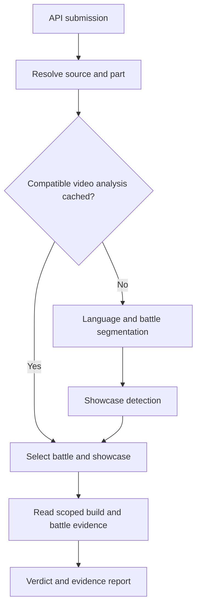

# Migrating the original reviewbot to the current analysis pipeline

**Scope:** analysis-engine changes, independent of local queue files, browser userscripts, Windows helpers, or local playback links.

**Reference state:** the implementation developed through 2026-10-16, including the applied five-second post-disappearance ending window.

**Evidence boundary:** this guide describes the code snapshots, changes, and test results available in this project conversation. It is not a fresh audit of the current upstream repository. Statements about the earlier implementation refer to the supplied original files and README. Sections explicitly marked **Proposed** describe migration recommendations or safeguards that are not implemented in the current version.

## 1. The architectural change

The main change is to separate **source-video analysis** from **submission-specific judging**.

A submission is a claim about a battle. A video is a container that may hold several battles, resets, showcases, previews, and unrelated footage. Treating those as one object causes evidence from one run to be assigned to another.

The migrated engine needs three layers:

| Layer | Owns | Can be reused across submissions? |
|---|---|---|
| Source | Video identity, part identity, downloaded bytes, duration, dimensions | Yes |
| Video analysis | Language evidence, boundary events, battle attempts, showcase candidates, diagnostics | Yes, within a compatible analysis configuration |
| Submission analysis | Selected battle, selected showcase, build assignments, submitted-versus-observed comparison, verdict | Only when its own inputs and dependencies match |

Keep the original API queue intake, authentication, claiming, and human decision workflow. Its queue runner should call an analysis coordinator after preparing sources. The coordinator resolves evidence scope before `judge.py`, `hud.py`, and `gp.py` run.

This is more than replacing one scanner. The selected intervals and source indices must become a contract used throughout the engine.

## 2. Implementation status at a glance

| Change | Current implementation | Main complexity |
|---|---|---|
| Shared source caching | Implemented | Same source across different URLs; Bilibili parts remain distinct |
| Video-level segmentation and showcase reuse | Implemented | Reuse completed CHECK/empty results without confusing them with interrupted work |
| Early language selection | Implemented with uncertainty handling | Build evidence may be absent, ambiguous, or far from the beginning |
| HUD-based boundary state machine | Implemented | HUD disappears during ordinary animations as well as endings |
| Six-second absence / HUD-return restart search | Implemented | Distinguishing restart from animation requires prompt OCR |
| Five-second post-disappearance ending window | Applied as a manual update | A start/end prompt can occur outside a short search window |
| Opening HUD treated as an inferred first start | Implemented; mocked tests completed | Recording start is not necessarily the actual battle start |
| Timestamp-to-battle selection | Implemented | Incomplete attempts, close starts, offsets, and ambiguous selection |
| Individual/shared showcase association | Implemented, conservative | Same character can appear with different builds in one source |
| Scoped build extraction and conditional retries | Implemented | Character transitions, fading locks, incomplete title panels |
| Selected battle sheets | Implemented | Retaining source timestamps and correct part/index |
| GP scanning during boundary scanning | Not implemented | Different crops, cadence, filtering, and result semantics |
| Search the full absence gap before declaring an attempt aborted | Not implemented | Need to recover a missed end without inventing one |
| Replace ordinary start OCR with HUD-appearance detection | Not adopted | Proposal was cancelled; start OCR remains at 2 fps |
| Automatic encounter/boss identity verification | Not implemented | Submitted encounter text is not observed identity evidence |

## 3. Normalize API submissions into independent run claims

### Required migration

Accept one to four populated character slots. Validate the Light Cone, Eidolon integer, and Superimposition integer only for populated slots. Do not require exactly four characters.

Normalize multi-side submissions into independently selectable run claims while retaining their parent review/group association. Each child needs its own submission identity, character/build claims, timestamped source URL, and side metadata.

Keep these identities separate:

- Parent review ID: the moderation object that a human opens.
- Child run ID: the run claim being analyzed.
- Source ID: the reusable media object.
- Part ID: the selected part within a multipart source.
- Battle interval: the selected attempt in that part.

### Why it is difficult

A grouped payload may contain three sides with different source URLs, three timestamps in one URL, or one untimestamped first side followed by two timestamped sides. Splitting the payload must not overwrite child URLs with the parent URL or merge child IDs into the parent review ID.

A review can therefore produce multiple run reports linked to the same parent. Deciding how those reports roll up into one moderation decision is an API/product policy separate from evidence extraction.

The current independent-run workflow should not be interpreted as proof that passing an unsplit `runs` object through the original runner produces equivalent per-side results. The API adapter needs to perform that normalization deliberately.

## 4. Source identity and downloading

### Required migration

Introduce shared source storage through a module such as `video_cache.py`. A run should reference prepared media rather than forcing a new download for every submission.

For known providers, normalize identity using the provider's media identifier. Timestamp and tracking parameters should not create different YouTube sources. Preserve Bilibili's selected `p=` value: part 2 and part 3 can contain entirely different battles and builds.

A source manifest should record which prepared file represents each source/part. Preserve online provenance so reports link to the correct part and timestamp.

### Why URL equality is insufficient

The same YouTube video can appear as a short URL, a watch URL, or a URL with tracking and timestamp parameters. Conversely, two Bilibili URLs with the same BV identifier can select different parts.

Different layers may need different keys: a multipart container can share download metadata, while the prepared file for each part needs an independent content identity. Do not collapse those layers into one generic “video key.”

### Proposed deployment safeguards

If the API service runs several workers, add per-source coordination for downloads and publication. The single-process workflow we developed does not establish that concurrent writers are safe.

Publish a completed file/manifest only after successful preparation. A directory existing on disk is not evidence that a download or analysis completed.

## 5. Cache design is part of correctness

### Required migration

Cache reusable stages separately:

| Artifact | Depends on |
|---|---|
| Prepared media | Source/part identity and actual downloaded content |
| Boundary scan | Content, OCR model, crop/detector logic, sampling and recovery settings |
| Showcase scan | Content, relevant boundary/exclusion intervals, showcase detector/settings |
| Build extraction | Content, source index, selected showcase interval, extraction code/settings |
| Build interpretation | Extracted evidence, OCR/model/data versions, candidate identities, reading logic |
| Battle sheets | Content, selected interval, sampling/layout settings |
| Submission judgment | Claims, selected evidence and analysis results |

Reuse a completed boundary scan even when it produced CHECK or no complete battle. Another submission referencing the same video does not, by itself, justify repeating the scan.

The current showcase flow uses a completion marker and a signature. This distinguishes a completed empty/uncertain scan from a process that stopped before publishing valid results.

### Complexities to account for

**Negative results need provenance.** “No banner found” under an old model or crop should not become permanent truth after the detector changes. Reuse within a compatible signature; invalidate when relevant inputs change.

**Existence is not completion.** A partially written JSON file, an empty output directory, and a completed scan with zero findings are three different states.

**Cache correctness is layered.** A reporting-only edit need not invalidate downloaded media. A boundary edit can change showcase gaps and invalidate downstream selections. Avoid treating every cache as either globally valid or globally deleted.

**Language selection can depend on the submission.** The early selector uses submitted names as matching candidates. A source-level cache therefore needs care when a later submission supplies a different character set or an explicit model override. Do not assume every analysis artifact is independent of the claim merely because its filename sits in a video cache.

**Code signatures have limits.** The current workflow fingerprints relevant files and settings. A production port should audit whether every model/template/data dependency that changes a result participates in the appropriate key. This is a recommendation, not a claim that the current dependency coverage is exhaustive.

**Retention has dependencies.** Evicting a cached video while reports or extracted evidence still reference it changes what a reviewer can inspect. Define retention for sources and derived artifacts together.

## 6. Move language selection before boundary scanning

### Required migration

The original build-reading language selection must become available early enough to guide the boundary scan. Reuse menu/build sampling and localized character/Light Cone matching, including a search near the video's end for likely showcase material.

Use conservative scoring: script evidence contributes to selection, but weak name matches or close competing models remain uncertainty. The adopted behavior can continue with legacy selection and attach a CHECK warning rather than terminating immediately.

Scan boundaries with the selected model first. Existing model-specific results should be reusable. Alternate models are a recovery path, not a reason to unconditionally repeat every successful scan in every language.

### Why it is difficult

- The showcase can be at the beginning, between battles, or only at the end.
- There may be no showcase at all.
- OCR can recognize another language's text partially; recognition does not establish the language conclusively.
- A watermark, player name, or UI label can outscore a damaged title if irrelevant text is admitted.
- A different submitted character set changes candidate matching evidence.
- The detector can be confident about a script but uncertain about the particular model or title.

Author-name characters should not be treated as proof of the video's game language. That was discussed as possible contextual evidence, not established as a reliable language selector.

Record selection candidates, scores, uncertainty reasons, and the actual model used. A report should explain a fallback rather than silently presenting it as certain.

## 7. Add the HUD-based boundary scanner

### State and sampling behavior

| State | Behavior | Confirmation |
|---|---|---|
| Searching for start | OCR upper-centre banner region at 2 fps | Plain start or first-wave `1/x` prompt |
| Active battle | Visual top-right HUD matching at 2 fps | Presence tracking only |
| Sustained disappearance | After 15 seconds absent, inspect the earlier disappearance window at 8 fps | Recognized boundary prompt |
| HUD return | After at least six seconds absent and two positive samples, inspect return window at 8 fps | Recognized new start or end |
| Active battle unresolved | Broader 4 fps recovery | OCR evidence; otherwise incomplete |
| No starts anywhere | Full-range 4 fps recovery | OCR evidence; otherwise CHECK |

The disappearance window begins approximately two seconds before the last positive HUD sample and now extends five seconds after absence began. The return window uses 2.5 seconds before the confirmation sample and three seconds after it.

Intermediate waves such as `2/2` are not required for a complete segment. A plain unnumbered start is valid. Intermediate waves can remain diagnostic clues in retained recovery paths.

### HUD detector details

The current detector normalizes the active picture width, extracts a top-right region, filters for bright low-saturation icon pixels, and compares several template scales. Pause is the primary cue, with speed/auto matching as an alternative.

The left action-order template was removed after poor matching. Do not document the current detector as requiring both sides of the screen to disappear.

Symmetric horizontal black-bar handling is retained. This is not proof of correct behavior for every pillarbox, off-centre crop, tablet layout, mobile UI scale, or overlaid recording.

### Why sustained absence is necessary

Controls disappear during animations as well as battle endings. Their disappearance should schedule an OCR search, not manufacture an end timestamp.

Two consecutive positive samples are required when confirming HUD return so a single accidental template match does not immediately reset the absence state. At 2 fps those samples are half a second apart.

The six- and 15-second thresholds serve different purposes. Shorter restart checks cost additional OCR around ordinary animations; longer ending confirmation avoids treating those short animations as ending cues.

### The confirmation wait requires revisiting footage

An ending might occur at time `E`, while the 15-second absence is only confirmed later at `C`. After recognizing the ending, resume start search just after `E`, not after `C`.

Otherwise a new battle that began during that waiting period could be skipped. The implementation explicitly revisits that footage.

### Sampling phases matter

A short banner can fall between 2 fps samples. Increasing to 8 fps inside a short window increases opportunities to capture it, but does not establish recognition accuracy. The frame generator's seek point and sample phase also affect the nominal timestamps.

Keep source timestamps and sampling metadata, and compare boundaries with a tolerance during testing rather than demanding identical fractional timestamps from different grids.

## 8. Resets, abandoned attempts, and missing endings

### Required representation

A segment needs separate start and end fields, status, warnings, and provenance. A missing end must stay missing. Do not close an abandoned attempt at the next start and then treat that artificial endpoint as a verified Battle Over.

If a new start is recognized before the prior attempt has an end, retain the prior attempt as incomplete/CHECK and create a new segment. Store and log both timestamps.

In the tested reset case, the incomplete attempt began at `839.625s`, and the restart began at `882.75s`. The HUD disappearance search around the earlier transition did not include the restart. Adding HUD-return OCR found it.

### Current limitation: missed end versus genuine reset

A new start proves that another battle began. It does not prove why the prior battle stopped.

The second investigated video had a start at `188.5s`, HUD disappearance at `516.5s`, and the next start at `537s`. Ending OCR originally stopped at approximately `519.5s`; the user reported Battle Over near `520s`. The scanner marked the earlier battle incomplete because it never recognized that end.

The applied change extends ending search through `absence_start + 5s`. It addresses that search-window coverage issue, but the actual recognition still requires testing.

### Proposed additional recovery — not currently implemented

Before classifying a new-start transition as an incomplete prior attempt, search any unexamined part of the intervening absence gap for Battle Over.

Bound this search to the gap and stop before the new start. Retain incomplete/CHECK if no reliable ending is found. This is preferable to inferring an end from the mere existence of another start.

## 9. Videos beginning mid-battle and opening previews

### Current behavior

If HUD is detected at the recording's first two 2 fps samples, the scanner can create an inferred start at the scan range's beginning. It then tracks the active battle normally instead of spending the entire video hunting for an unavailable start banner.

A recognized start banner takes priority. The synthetic event has `source: opening_hud` and `start_inferred: true`; the segment retains inferred-start metadata.

### Complexities

- Time zero is the beginning of available footage, not necessarily the actual beginning of the fight.
- A video can open with a preview of an ending, then show the full run.
- An opening animation can hide the HUD in the first sample.
- A template false positive in both samples can produce an incorrect inferred start.
- Cropped starts may omit earlier cycles, damage, or GP evidence relevant to the claim.

The opening-HUD behavior has mocked logic tests; that is different from broad real-video validation.

The existing parser also handles unmatched ending prompts before a later first start as possible previews. Opening inference and preview handling should be tested together rather than assumed compatible for every edited video.

### Proposed provenance propagation

Carry inferred-start provenance into the final selection and report, and explicitly decide what review policy applies to truncated openings. The current selection object primarily carries the chosen interval; do not assume every event-level annotation is automatically visible in the report.

## 10. Partition complete battles from exclusion intervals

### Required migration

Do not require every attempted battle in a video to be complete before allowing analysis of any successful battle.

Partition the timeline into:

1. Complete, usable battle segments.
2. Unresolved intervals that must not be treated as verified battles or ordinary showcase gaps.

For an attempt with a missing end, an exclusion interval can extend to the next known start or the video end. That closes a masking interval for gap detection, not a factual battle interval.

Merge overlapping exclusion intervals and reject overlap between usable battles and unresolved zones when it makes selection inconsistent.

### Why the distinction matters

If a reset interval is discarded entirely, the showcase detector may search gameplay footage as a supposed gap. If every unresolved attempt blocks the entire source, later clearly complete battles become unusable.

The coordinator therefore passes synthetic exclusion barriers to the gap scanner while retaining the original attempts and warnings for diagnostics. Indices then need remapping: the gap scanner's “after interval 3” may include an exclusion barrier that is not the third completed battle.

Off-by-one errors here can attach a correct showcase to the wrong battle even when the underlying detections are individually correct.

## 11. Select the submission's battle

### Current rules to port

| Situation | Selection behavior |
|---|---|
| Timestamp inside exactly one complete battle | Select it |
| Timestamp outside battles, one complete start in the next 90 seconds | Select that battle |
| More than one containing/following candidate | CHECK |
| Selected start more than 30 seconds before/after submitted timestamp | Add CHECK reason |
| Selection skips an unresolved attempt | Add CHECK reason |
| Timestamp points into a detected showcase | CHECK |
| No timestamp or timestamp zero | Consider the first attempt; an earlier incomplete attempt blocks silent skipping |

Store the submitted position, detected start, signed offset, whether selection snapped forward, and whether an incomplete attempt was skipped.

### Difficult cases

**Incomplete nearby battle:** the closest start may exist but have no recognized end. A complete-battle selector cannot select it just because the link is close. Report that underlying reason instead of only saying the timestamp is ambiguous.

**Timestamp before a reset:** the timestamp may refer to the abandoned attempt, its setup, or the following successful run. The 90-second forward rule is a policy with review warnings, not proof of uploader intent.

**Exact boundary semantics:** define whether end timestamps are included. Avoid selecting two adjacent segments because one ends exactly where another starts.

**URL formats:** parse seconds and duration-style timestamps consistently; preserve Bilibili part selection and handle known malformed short links deliberately. Unknown timestamp syntax should not silently become zero.

**Cache versus claim:** changing the submission timestamp should normally select from existing source analysis rather than force another full boundary scan.

## 12. Detect and associate showcases

### Required migration

Detect character-menu evidence in eligible gaps and store candidate sections with source index, start/end, search-window bounds, menu-page evidence, and sequence position.

Associate by temporal structure:

- Interspersed battles with a corresponding showcase after each battle.
- One shared showcase before several battles.
- One shared showcase after several battles.
- Nearby fragments belonging to the same eligible gap.

The current implementation groups fragments by their gap/sequence metadata, combines the interval/evidence, and conservatively rejects mixed or uncertain patterns. A shared candidate produces a human-check reason.

### Why a proximity-only association is insufficient

The nearest showcase may belong to the preceding battle, to the entire video, or to a later edited insertion. A repeated showcase can look like two independent showcase sessions even when it shows exactly the same builds twice.

Do not require the number of raw showcase fragments to equal the number of battles. Conversely, do not automatically merge every nearby menu session across intervening battle footage.

### Avoid selecting builds merely because they match the claim

Sequence association should not choose the showcase that best agrees with submitted E/S/LC values. That would bias evidence selection toward approval.

Once a shared section is selected, identify and read its build occurrences independently. If the same character has different builds and the battle-to-occurrence mapping remains ambiguous, return CHECK.

### Remaining special cases

A multipart video can put showcases in another part. The current selected-part behavior avoids contaminating one independent part with another, but a general automatic rule for deciding which unrelated part supplies its showcase has not been established. Do not assume downloading all parts resolves that association.

## 13. Scope extraction and every retry consistently

### Required migration

Pass a single selection contract to extraction and judging. It should distinguish battle source/index/interval from build source/index/interval.

Update all code paths, not just the first list of Light Cone/Eidolon frames:

- Initial menu extraction.
- Language samples during build reading.
- Character Details matching.
- Character identity assignment.
- Light Cone and Eidolon frame collection.
- Native/denser retry decoding.
- Build sheet generation.

The previous multipart issue persisted when the initial frame filter was changed but another matching loop still visited every video index. Audit every loop over `videos`, `tabs<i>`, and decoded retry frames.

### Timestamp and coordinate contracts

Keep source timestamps attached to evidence. If a decoder seeks into the showcase, do not accidentally report the interval-relative frame time as the full-video time.

Keep image coordinates consistent too. A crop offset, active-picture offset, and menu-layout coordinate refer to different spaces. A node crop outside the frame should produce unreadable evidence, not an OpenCV crash.

Frame filenames are useful diagnostics but should not be the only evidence identity. Several retries can use close timestamps, and different parts can contain the same timestamp.

## 14. Character identity is a separate decision from E/S/LC reading

### Required migration

Use character header evidence, localized Eidolon-name evidence, nearby Details pages, and other supported identity cues to assign pages to characters. Preserve weak/ambiguous assignment information.

A correctly read Eidolon count on the wrong character is still an incorrect result. More OCR samples do not solve that assignment problem by themselves.

### Difficult cases

- The header updates before the page contents during a character switch.
- A watermark covers a header but leaves Eidolon names readable.
- Multiple submitted characters share the same Light Cone.
- The Trailblazer's player name is not the canonical submitted character name.
- A character not in the submitted team appears in a shared showcase.
- A missing page tempts elimination-based assignment to the only remaining character.

Conditional retries must confirm that sampled frames still belong to the intended character. Otherwise a retry can strengthen evidence for the wrong assignment.

The earlier incident assigning The Herta's Eidolon page to Anaxa illustrates the failure class; it does not establish that every such identity case is solved by current retries.

## 15. Conditional build retries and uncertainty

### Required migration

Preserve the normal fast path for clear evidence. Trigger denser reads only when a result is unresolved or contradictory.

| Reading | Retry motivation | Main failure modes |
|---|---|---|
| Light Cone title | Weak/uncertain title match or unsuitable captured frame | Page opens before title panel settles; UI labels mistaken for titles |
| Superimposition | Missing or conflicting S read | Small text, blur, wrong line, page transition |
| Eidolons | Contradictory lock pattern, insufficient frame support, uncertain node scores | Fading locks, scale mismatch, wrong tab, wrong character |

Retry inside the selected showcase and character context. Save retry metadata and evidence frames so the result can be inspected.

### Eidolon-specific complexity

A lock detector is not simply six independent binary classifications. A reading should be consistent with the ordered unlock pattern and supported across suitable frames.

The adopted direction was finer template-scale search and aggregation of lock evidence across confirmed same-character frames, while retaining CHECK when evidence remains contradictory. Combining scores indiscriminately across characters or animated transitions would corrupt that aggregation.

A maximum across many frames can also amplify an isolated false match. Repeated support and confidence thresholds matter; more frames do not automatically mean stronger evidence.

### Light Cone-specific complexity

A title retry should not replace weak title evidence with a clearly readable generic UI label. The observed Chinese `角色攻略` reading was an example of irrelevant text being selected from an unsuitable frame. That incident was not established as fully resolved merely by adding extra sampling.

The retry result should distinguish a readable different Light Cone, an uncertain candidate, and no usable title evidence.

## 16. Scope HUD metrics, UID, and Global Passive checks

### Required migration

Pass selected battle/build sources and intervals into `auto_judge.py` and its dependencies. Scope battle metric and GP work to the selected battle, and retain the correct source index on evidence.

The original result logic should continue using the relevant in-battle evidence rather than assuming a final summary screen belongs to this specific attempt.

HUD presence used for segmentation and HUD value reading in `hud.py` are different detectors. A pause icon match says nothing about whether a cycle counter is readable.

### Global Passive remains separate

Boundary OCR and GP OCR have different spatial regions, banner text, filtering, and sampling needs. The current implementation does not merge these passes or start parallel GP work during segmentation.

The earlier GP investigations exposed two distinct problems: overly permissive text matching can create false positives, while split-line OCR and preprocessing/filter decisions can create misses. Simply widening a crop or lowering a match threshold is not a complete migration strategy.

### Proposed GP-cache design

If GP results are later cached for a whole video, preserve timestamped observations and enough repeated evidence to answer each selected interval independently. A video-level union such as “Castorice seen somewhere” is insufficient: a trigger in battle 3 must not satisfy battle 1's claim.

Do not treat that design as already implemented.

## 17. Judgment semantics and reporting

### Required migration

Keep these categories separate:

- Confirmed observed mismatch.
- Unreadable or contradictory evidence.
- Evidence not captured/assigned.
- Ambiguous battle or showcase association.
- Analysis exception or missing dependency.
- Report delivery failure.

Propagate segmentation and language-selection warnings into the final human-check reasons. A high numerical confidence score should not erase a categorical CHECK condition.

When analysis stops early, display the submitted build with an explicit “not verified” status rather than presenting the claim as observed evidence or omitting the team entirely.

Include timestamp selection information, online evidence links, the selected Bilibili part, and diagnostic references appropriate for the original deployment. Local folder and mpv routes are outside this migration's scope.

### Improve failure explanations

A report saying “timestamp does not uniquely identify a battle” can conceal a detected nearby start whose ending was missed. The useful explanation identifies the failed stage and the missing evidence.

Confidence is a deduction-based evidence score, not a calibrated probability of moderation correctness. Encounter identity and duplicate-site checks remain separate limitations unless independently implemented.

## 18. Selected evidence sheets

### Required migration

Generate battle sheets only for the selected battle interval. Preserve original timestamps, cache by source and interval, and remove/exclude stale pages from a previous interval.

Use the selected showcase for the build sheet. Shared sections may include several runs' builds, so their interpretation still needs the associated warning.

Attach the build sheet and the first and last battle pages where available. Deduplicate a single battle page instead of attaching it twice.

### Complexities

- The battle video index may differ from the showcase index.
- A short interval can produce one page; a long one can produce many.
- Sampling may not land exactly on the ending, so endpoint capture needs handling.
- Video-end seeking can fail and needs a bounded fallback.
- Sheet timestamps must remain online-source timestamps after interval seeking.
- Stale `01.jpg`, `02.jpg`, etc. cannot be assumed valid solely because the folder exists.
- Discord image grouping and attachment delivery are presentation concerns separate from evidence selection.

## 19. Long-video policy in an API deployment

The current policy can be ported without local files:

| Duration | Policy |
|---|---|
| Up to 20 minutes | Normal admission |
| Over 20 minutes and under one hour | Wait for two distinct submission IDs referencing the source |
| One hour or longer | CHECK instead of automatic analysis |

Use persistent storage outside the transient queue response. Duplicate appearances of one submission must not satisfy the two-reference requirement.

A deferred run should become eligible when another reference arrives, even if the first item has moved out of the currently fetched queue page. Preserve enough input/provenance to reconsider it safely.

**Proposed deployment concern:** in a multi-worker service, admission/reference updates and deferred-job activation need concurrency control. The local single-writer registry is not a substitute for that service-level design.

## 20. Integration surface in the original repository

| Component | Migration responsibility |
|---|---|
| Original API queue runner | Normalize independent run claims; invoke source/selection coordinator; retain existing API workflow |
| `prep.py` / media preparation | Reuse sources, preserve part identity and online provenance |
| `video_cache.py` | Source and derived-artifact reuse with explicit completion/invalidation |
| `segment_pipeline.py` | Early language evidence, cached video analysis, partitioning, battle selection, showcase association, extraction scope |
| `scan_battle_boundaries.py` | HUD state machine, prompt matching, inferred starts, resets, recovery and diagnostics |
| `scan_showcases.py` | Gap-scoped menu detection and candidate evidence |
| `tabs.py` integration | Extract only selected showcase evidence and preserve source coordinates/times |
| `judge.py` | Identity-aware build reads, conditional retries, uncertainty output |
| `auto_judge.py` | Consume selected indices/intervals; combine results and CHECK reasons |
| `hud.py` / `gp.py` callers | Restrict evidence to the selected run/source |
| `battle_sheets.py` or equivalent | Interval-specific cached evidence sheets |
| `report.py` | Observed-versus-submitted clarity, timing/association warnings, selected online evidence |
| Persistent service storage | Optional long-video references and deferred work |

Avoid copying the local runner wholesale into the API runner. Port the analysis contracts and coordinator calls, then adapt the original runner's existing error handling, job lifecycle, and delivery behavior.

## 21. Recommended migration order

The following is a proposed implementation sequence, not a claim that upstream already contains these stages:

1. Define source, part, battle, showcase, and submission identities and timestamp conventions.
2. Add source reuse and explicit stage completion records.
3. Introduce the selection contract while preserving existing judging behavior on simple single-run sources.
4. Add boundary scanning, diagnostics, and complete/incomplete partitioning.
5. Implement timestamp selection and its warnings.
6. Add showcase detection and temporal association.
7. Scope every extraction/matching/retry path to selected evidence.
8. Port conservative build uncertainty and conditional retries.
9. Scope battle metrics and GP checks; verify online evidence links.
10. Replace whole-video sheets with selected evidence sheets.
11. Add persistent long-video admission/reference policy if desired.
12. Roll out with a regression corpus and compare accuracy before enabling faster defaults broadly.

Introducing segmentation without scoping the downstream readers leaves the main contamination problem intact. Adding shared caches before separating claim-dependent results can instead make that contamination persistent across submissions.

## 22. Regression tests that matter

### Boundary and state tests

| Case | Expected property |
|---|---|
| Plain unnumbered start and end | One complete battle |
| Numbered waves | First start and end suffice; middle waves do not create new battles |
| Brief ending behind an animation | Targeted recovery can capture the banner; absence alone never closes the battle |
| Ordinary HUD-hiding animation | No invented battle boundary |
| Reset with no Battle Over | Prior attempt incomplete; new start separate |
| Ending missed near the next battle | No automatic claim that the first run was successfully verified |
| Opening ending preview | No fabricated complete opening run |
| Video begins with battle HUD | Inferred opening start retains provenance |
| HUD not detected on a new layout | Recovery/uncertainty remains available |
| Video ends soon after a banner | Test behavior when there are fewer than 15 post-disappearance seconds |

### Association and scope tests

- Several independent battles with individual showcases.
- Several battles with a shared terminal or opening showcase.
- Repeated showcase fragments in the same gap.
- Two builds for the same character in one shared showcase.
- Bilibili `p=2` and `p=3` with different teams.
- A showcase in another part whose association is ambiguous.
- A missing character page adjacent to another character's valid page.
- An unresolved attempt that must be excluded from showcase gaps.

### Cache and reporting tests

- Same video across distinct submission URLs downloads once under supported identity normalization.
- A second submission reuses completed boundary/showcase results, including CHECK/empty outcomes.
- Interrupted scans do not look completed.
- A detector change invalidates the relevant derived result while retaining source reuse.
- A timestamp edit changes selection without pretending the source itself changed.
- Stale sheets from another interval are not attached.
- A failed analysis labels submitted builds unverified.
- A delivery failure does not become an analysis verdict.

### Performance measurement

Compare both accuracy and cost: elapsed time, decoded frames, OCR calls by stage, recovery intervals, complete/incomplete segments, reset detections, and selected evidence.

Run methods sequentially under comparable conditions and reverse their order in another trial to inspect warm-cache effects. After changing the scanner default, the benchmark's old-method subprocess must explicitly use `--full-ocr`.

One recorded single-video test took `683.295s` with the full-OCR baseline and `126.895s` with HUD scanning, with equal end timestamps and a `0.25s` start difference. The reset-aware multi-run test took `557.545s`, used `1,744` OCR calls, and recorded four complete battles plus one incomplete attempt. The additional return checks increased work relative to the earlier version that missed the reset.

These measurements describe those specific tests. They are not general accuracy or runtime guarantees.

## 23. What to preserve in diagnostic output

For each source-analysis result, retain:

- Source/part provenance, content/signature identity, range and dimensions.
- Selected OCR model and language-selection uncertainty.
- Boundary events with source type, timestamps and evidence references.
- Raw OCR text and recognition matches with crop/time context.
- HUD presence samples and matching scores.
- Complete segments, incomplete attempts and exclusion intervals.
- Retry windows, their reason, rate, hits and cost.
- Showcase candidates, fragment grouping and association evidence.

For each submission result, retain:

- The exact normalized claim and selected source indices/intervals.
- Timestamp offset and skipped-attempt information.
- Build assignments, readings, retries and uncertainty.
- Battle metric/GP evidence within the selected scope.
- Verdict reasons, deductions, report payload and delivery outcome.

The purpose is to answer “was the text unreadable, rejected by matching, outside the crop, outside the search interval, or assigned to the wrong character?” without repeating the entire video analysis.

## 24. Scope exclusions

This migration does not require `submissions.json`, a polling batch file, Tampermonkey, Firefox file-access extensions, a localhost folder opener, mpv links, or Windows path-entry fields. Keep those outside the original bot's analysis-engine port.

The source-sharing, segmentation, selection, evidence scoping, retry, caching, and reporting changes remain applicable when submissions arrive through the original moderation API.
